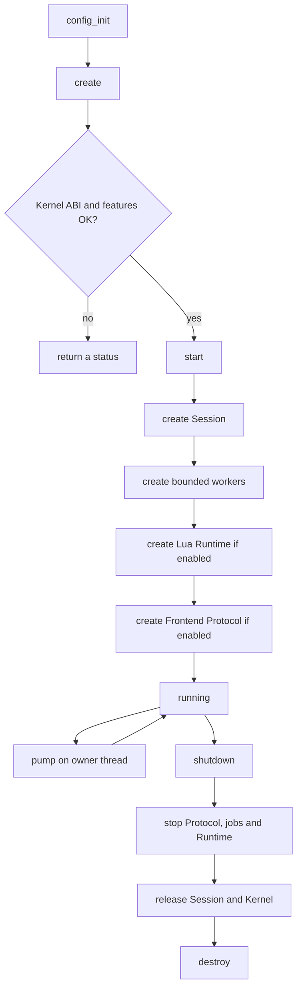

# Architecture

This guide explains how the Backend is divided into small parts and why those parts exist.

## 1. The main rule: one owner for each kind of data

The repository layout and dependency direction follow the
[Spec module-boundary contract](https://github.com/cdin-editor/spec/blob/main/docs/architecture/module-boundaries.md).
Kernel is installed as an external C library; the Backend source tree does not
contain or include a sibling Kernel checkout.

The Backend coordinates other components; it should not duplicate their data.
Its lifecycle follows [LIFE-001 and LIFE-002](https://github.com/cdin-editor/spec/blob/main/docs/architecture/lifecycle.md): validate and create Kernel first, initialize Runtime before exposing the Protocol to Frontends, and unwind completed stages on failure. During graceful shutdown, accepted job completions are delivered on the owner thread before the Runtime is destroyed, so a completion callback cannot target an already-closed Lua state.

| Data or responsibility | Owner |
|---|---|
| Document bytes, versions, edits, snapshots, undo/redo, notifications | Kernel |
| Commands, keymaps, editor policy, UI model, document clients | Runtime |
| Session identity, lifecycle, OS services, native integration, Frontend connections | Backend |
| Pixels, terminal cells, font shaping, visual wrapping | Frontend |

For example, when a user edits a document, Runtime requests a mutation. Backend calls Kernel through its adapter. Kernel stores the new bytes and history. Runtime reacts to notifications and publishes a new semantic UI model. A Frontend renders that model. The Backend never needs a duplicate string containing the document.

## 2. Module boundaries

### `core/`

Contains shared Backend status codes and checked arithmetic helpers. Backend status values are not Kernel status values. The adapter maps Kernel results into Backend results so the rest of the project does not depend on Kernel enum numbers.

### `kernel/`

This is the only module allowed to include `cdin/kernel.h`. It validates the ABI and feature set, creates the Kernel, configures the Kernel-owned logger, wraps raw Kernel handles in generation-checked Backend handles, and implements the Runtime document service. The header and library arrive through the pinned `cdin-kernel` package and `pkg-config`; the adapter is the only code that needs to know the vendor ABI. See [BE-003 and BE-004](spec-traceability.md#1-lifecycle-and-kernel-boundary).

A generation-checked handle contains a slot number and a generation number. When a slot is released, its generation changes. A stale Lua userdata value therefore cannot accidentally refer to a different object that later occupies the same slot.

### `runtime/`

`lua_host.c` owns only the bridge lifecycle: allocate the Lua state, load
Runtime, pump it, and shut it down. The implementation is split into
`lua_host_common.c` (error and value conversion),
`lua_host_api.c` (host metadata, logging, and UI publication),
`lua_host_documents.c` (document, snapshot, transaction, history,
notification, and search calls),
`lua_host_services.c` (filesystem, process, and clock calls), and
`lua_host_register.c` (metatables and API registration).
`lua_host_internal.h` shares private declarations; none of these Lua-specific
details are part of the installed public C API. The bridge is optional at
build time, but a Runtime-enabled application requires Lua 5.4. [Spec ADR-0019](https://github.com/cdin-editor/spec/blob/main/docs/adr/ADR-0019-runtime-bridge.md)
selects the PUC Lua 5.4 C API for v1. LuaJIT FFI and MetaCall are out of scope.
The mechanism is implemented. A committed live Backend workflow exercises the
real Runtime source; its green result remains a release gate and must not be
inferred from Kernel-independent tests.

Lua is owned by the Backend's creating thread. Worker threads never enter Lua, call Lua callbacks, or touch Lua userdata.

### `session/`

The Session stores document identity and lifecycle metadata plus view-to-document relationships. It does not store document contents or undo history. This small data structure makes it possible to check whether a document still has views before closing it.

### `protocol/`

The Protocol module contains a transport-independent deterministic-CBOR codec, bounded per-client queues, sequence validation, driver/observer permissions, atomic flush groups and ACKs. The Lua Host bridge projects `cdin.ui-model.v1`, queues inbound Frontend events, dispatches them on the Lua owner thread and serves version-pinned `view.request_lines` from a Kernel Snapshot. [ADR-0018](https://github.com/cdin-editor/spec/blob/main/docs/adr/ADR-0018-frontend-protocol-wire.md) fixes the wire format and standalone codec location. Concrete socket/named-pipe transport remains outside this source snapshot. Runtime
implements Host API 0.3.0 and its Protocol event/line-read entry points in the
companion Runtime repository; the Backend live-integration workflow consumes it.

### `os/` and `platform/`

`os/` contains operations with user-visible meaning: normalize paths, read/write files, list directories, inspect metadata, and start child processes. `platform/` contains the code needed to use the host operating system: thread primitives, clocks, and UTF-8/native path conversion.

This split means a new operating system implementation should usually be added to `platform/`, not copied into Runtime or Protocol.

### `jobs/`

The bounded worker pool performs CPU or I/O work away from the owner thread. Worker callbacks return plain C results. The owner thread later pumps completions and invokes completion callbacks. This is the rule that protects Lua's thread ownership and implements [BE-007 to BE-009](spec-traceability.md#2-threads-queues-and-system-services).

## 3. Lifecycle diagram

## 4. Thread model

There are two types of work:

- **Owner-thread work:** Lua calls, Kernel ABI operations, Session updates, protocol client operations, and completion callbacks.
- **Worker-thread work:** a bounded C callback that receives an immutable input/context and produces a result. It must not call Lua or access mutable Kernel/Runtime state.

`cdin_backend_pump()` processes only a bounded number of completions in one call. This gives the application control over latency.

## 5. Failure model

Public C APIs return a `cdin_backend_status`. Runtime services turn those statuses into a Lua error table with:

- `domain = "cdin.runtime"`;
- a stable machine-readable `code`;
- a diagnostic `message`;
- optional numeric `details` such as `expected`, `current`, `requested`, `length`, `required`, or `limit_id`.

A failure in one layer should be reported at the boundary where it occurs. Do not hide a Kernel error by replacing it with `INTERNAL` unless the cause is genuinely unknown.
